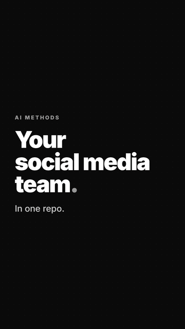
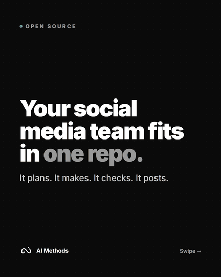
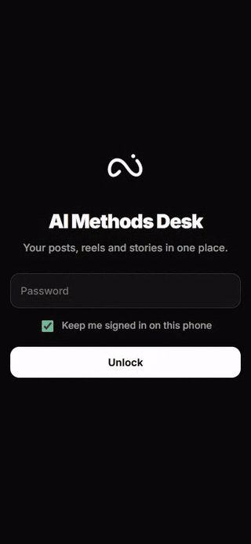
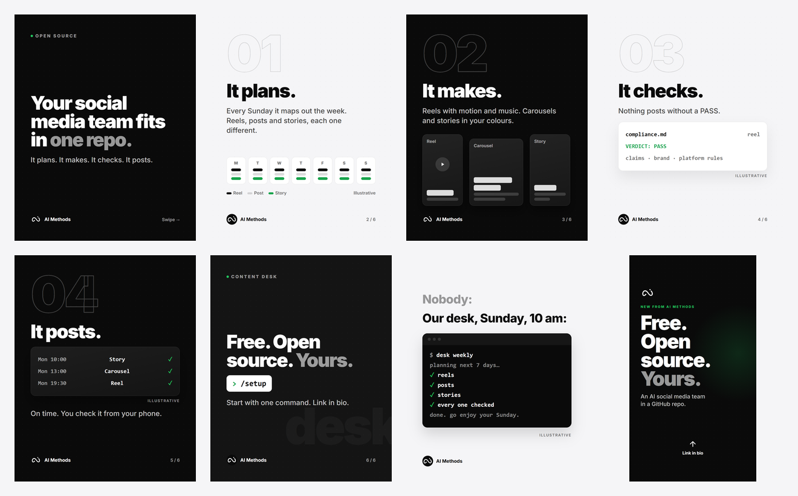
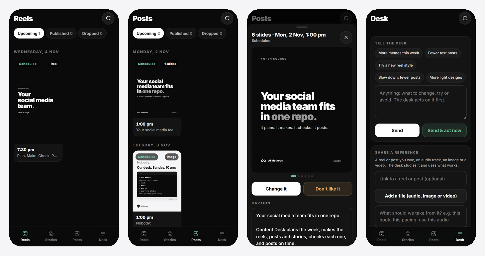

<p align="center">
  
</p>

<h1 align="center">Content Desk</h1>

<p align="center"><b>Your social media team. In one repo.</b></p>

<p align="center">
  📮 Need help to set it up? Mail us: <a href="mailto:quickca@thequickca.com"><b>quickca@thequickca.com</b></a>
</p>

<p align="center">
  
  &nbsp;
  
  &nbsp;
  
</p>

<p align="center"><sub>A reel, a carousel and the phone app. All made by this repo, for AI Methods.</sub></p>

---

## What it is

- An AI team for Instagram and Facebook.
- It plans your posts.
- It makes them: reels, posts, stories, memes.
- It checks each one.
- It posts them on time.
- It answers simple comments.
- You check it all from your phone.
- It runs on [Claude Code](https://claude.com/claude-code) and GitHub.
- It is free. It is open source (MIT).
- We use it for our own posts at [AI Methods](https://aimethods.co).

## What it makes

<p align="center"></p>

- Reels with motion and music.
- Posts with many slides.
- Stories.
- Memes.
- All in your colours, with your logo.
- No stock photos. No songs you don't own.
- See them all in [`content/`](content/).

## The phone app

<p align="center"></p>

- See what goes out, and when.
- Swipe through each post.
- Change the words or the time.
- Hold it. Post it now. Or drop it.
- Tap "Change it" or "Don't like it". The desk fixes it.
- Send a reel you like. It learns the style.
- It is one web page. It is locked with your password.

## Start in 5 steps

1. Get the code.
   - Click **Use this template** at the top of this page.
   - Or run: `git clone https://github.com/aimethods-co/content-desk`
2. Add the tools.
   - `npm install`
   - For a voice on reels: `pip install numpy==1.26.4 kokoro==0.9.4 soundfile==0.13.1` (and espeak-ng)
3. Open Claude Code in the folder.
   - `claude`
4. Type `/setup`.
   - It asks for your website. That is all it needs to start.
   - It finds your name, logo, colours and what you sell.
   - It shows you what it found. You fix what is wrong.
   - It walks you through each link: Meta, GitHub, the phone app.
5. Turn it on.
   - Set the repo variable `DESK_ENABLED` to `true`.
   - That's it. It runs by itself now.

**Stuck? Mail us: [quickca@thequickca.com](mailto:quickca@thequickca.com)**

## What you need

- [Claude Code](https://claude.com/claude-code) and a Claude plan.
- Node 20+, Python 3.12 and Chrome.
- An Instagram pro account, linked to a Facebook Page.
- A GitHub account.

## How it runs

| When | What it does |
|---|---|
| Sunday | Plans the next 7 days. Makes the first 2. |
| Each evening | Reads your notes. Makes the next day. Answers comments. |
| Each half hour | Posts what is due. |

- Each day gets at least 1 reel, 1 post and 1 story.
- No two reels in a row look the same.
- It tries one new thing each week.
- It all runs in GitHub Actions. Your PC can be off.

## How you talk to it

- Tap a button in the phone app.
- Or write in [`FEEDBACK.md`](FEEDBACK.md).
- Or just ask Claude: "plan next week", "make a reel about X".
- Problems show up in [`ISSUES.md`](ISSUES.md).
- What is coming up is in [`QUEUE.md`](QUEUE.md).

## Rules it keeps

- No post goes out without a **PASS** from the check.
- It only says what your site says. No made-up numbers.
- No fake reviews.
- It uses your logo as it is.
- It never spends money.
- It never DMs anyone first.
- Hard comments come to you. It does not reply to them.

## Where things are

| Path | What is in it |
|---|---|
| `desk.config.json` | Your name, time zone, repo |
| `.agents/product-marketing.md` | Who you sell to. What worked. |
| `.claude/skills/` | 29 skills. The 5 core ones: `setup`, `brand`, `compliance`, `calendar`, `replies` |
| `brand/` | Your colours (`brand.css`) and logo |
| `content/` | One folder per post |
| `scripts/` | Make, post, queue, music, voice |
| `admin/` | The phone app |

## One post = one folder

- `post.json`: what to post, and when.
- `compliance.md`: the check. Line one must say `VERDICT: PASS`.
- The images or the video.

```json
{
  "platforms": ["instagram", "facebook"],
  "media": ["png/slide-01.png", "png/slide-02.png"],
  "caption": "Your words here.",
  "publish_at": "2026-11-08T13:00:00+05:30"
}
```

- Many images = a carousel.
- One `.mp4` = a reel.
- `"format": "story"` = a story.
- No media = a Facebook text post.

## Good to know

- Times in the workflows are UTC. `/setup` sets them to your time zone.
- GitHub can run a cron job late. Need it on the dot? Call the workflow from an outside timer.
- Public repos get free Actions time. Private repos have a limit. Check your plan.
- Your keys stay in `.env` and GitHub secrets. They are never in the code.
- The phone app only holds your GitHub key, locked with your password.

## Help

- Mail: [quickca@thequickca.com](mailto:quickca@thequickca.com)
- Found a bug? [Open an issue](https://github.com/aimethods-co/content-desk/issues).
- Want us to set it up for you? Mail us.

## Credits

- Made by [AI Methods](https://aimethods.co).
- Some skills come from other open source repos. See [`third_party/`](third_party/).
- License: MIT. See [`LICENSE`](LICENSE).
